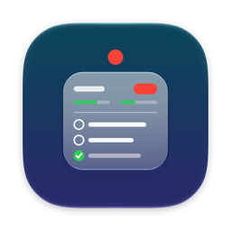

<p align="center">
  
</p>

# Clerk

A meeting note taker and coach for macOS, in one window. It works with all online meeting apps
(Zoom, Teams, Meet, FaceTime and others), because it records the sound of your Mac, not the
meeting app.

- **Prepare.** The prep is one markdown text with four headings: participants, agenda, talking
  points and prep notes. Fill it in yourself, or click **Copy for AI**, give it to an AI assistant,
  and paste its answer back.
- **Meet.** When you start, the window becomes a small panel under your camera, so you look at the
  camera when you read it. The panel shows the time, a Stop button and your talking points:
  the open ones at the top, and the ones you covered ticked below. People do not
  see the panel when you share your screen.
- **Get the notes.** When you stop, the window comes back and Clerk writes one markdown file:
  summary, decisions, action items, talking points, agenda, prep notes and the full transcript
  with a speaker for each turn. You pick who each speaker was from your participants, and the
  notes show in the window.
- **Watch it again (optional).** Turn on **Record the meeting window** in Settings. Clerk saves a
  video of the meeting app's window next to the notes. The notes window plays it: click the time of
  a line in the transcript to go there. When you name the speakers, Clerk shows the window as each
  one talks, and suggests the names that the meeting app shows.

Everything runs on your Mac. Your meetings do not go to the internet.

- Speech recognition: Parakeet TDT 0.6B v3 through FluidAudio (25 European languages). Clerk
  downloads the model (about 480 MB) the first time it starts.
- Speaker separation: pyannote community-1 through FluidAudio. Your microphone is always "Me".
  The other people are "Speaker 1", "Speaker 2"… until you name them.
- Summary and action items: Apple Intelligence (the on-device Foundation Models).
  Without Apple Intelligence, Clerk still writes the transcript.
- Video: ScreenCaptureKit records only the window that you pick. Vision reads the names in it.

## Install

Needs a Mac with Apple Silicon and macOS 26 or later. Clerk supports the current macOS and the
version before it.

With [Homebrew](https://brew.sh):

```sh
brew install --cask knorthfield/tap/clerk
```

Or download `Clerk.zip` from the [latest release](https://github.com/knorthfield/clerk/releases/latest).

## Use

1. Open Clerk and fill in the prep.
2. Click **Start Meeting** (⌘↩) when the meeting starts. The first time, macOS asks for access to
   the microphone and to system audio recording. Allow both.
   If you record video, macOS first shows its window picker: click the meeting app's window.
3. Click a talking point when you cover it, to tick it. Click again to untick it.
   If you added participants, tap a name in the panel when that person talks. After the meeting,
   Clerk uses your taps to fill in the speakers' names.
4. Click **Stop** in the panel. After a short time, pick the speakers' names, and the notes show.
5. Click **New Meeting** (⌘N) to go back to the prep.

The notes (and the videos, `.mp4`) go to `~/Documents/Clerk`. Change the folder in **Clerk › Settings…** (⌘,). The audio of each meeting
stays in `~/Library/Application Support/Clerk/<date and time>/` (`me.caf` and `others.caf`).

Clerk removes the sound of your speakers from your microphone, so the other people do not show
twice in the transcript.

## Build

Needs a Mac with Apple Silicon, macOS 26 or later, Xcode 26 or later and [XcodeGen](https://github.com/yonaskolb/XcodeGen).

```sh
echo 'DEVELOPMENT_TEAM = <your team ID>' > Local.xcconfig
xcodegen generate
open Clerk.xcodeproj
```

`./test.sh` generates the project and runs the tests.
